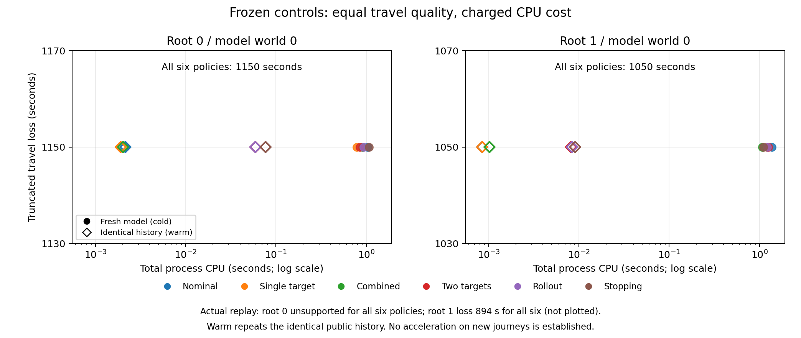

# V33：共享后验、后续下车适应与完整计费

**G2 仍未通过。** 本轮落实 V32 留下的公开历史与后续适应机制。
六种控制使用相同模型、完整既定菜单和公开信息；新增复杂控制的收益仍被便宜
组合等待吸收。逐项执行范围见 [PLAN_EXECUTION.md](PLAN_EXECUTION.md)。

## 完整回放

沿用 V31 拟合、20 秒支持、原 MCT 与 2400 秒截止；12 个 V32 根、64 个枢纽、
542 个续程变体全部保留。自己的到发站和本站出现信息跨换乘保存，每辆后续
车辆继续保留全部既定出口。每根独立抽 32 个原模型世界，共 384 个配对世界。

| 控制 | 模型平均损失（秒） | 比冻结主对照差（秒） | 较差世界数 |
|---|---:|---:|---:|
| 滚动名义 | 1601.197917 | 9.401042 | 7 |
| 单目标 + 滚动下车 | 1592.057292 | 0.260417 | 1 |
| 组合 + 滚动下车 | 1591.796875 | 0 | 0 |
| 两目标 + 滚动下车 | 1591.796875 | 0 | 0 |
| 两目标 + 一层 rollout（冻结主对照） | 1591.796875 | 0 | 0 |
| 两目标 + 标准链停止 | 1591.796875 | 0 | 0 |

后四者损失逐世界相同。名义、单目标相对主对照差的条件 Monte Carlo 标准误分别
为 4.110325、0.260417 秒。实际 12 根中，5 根到达、1 根确定失败、5 根端点缺测、
1 根原模型不支持；6 个可计分根的平均损失均为 1596.833333 秒，各方法公开动作相同。
原始回执：[roots/](roots/)、[summary.json](summary.json)。

8 个有差异世界的首次分歧已补完整公开历史：名义规则 1 次发生在车上、6 次在
站台；单目标的 1 次在站台。逐条回放均复现原损失，组合等待全部吸收这些差距。
见 [decision_gap_catalog.json](decision_gap_catalog.json)、[gap_receipts.json.gz](gap_receipts.json.gz)。

单目标唯一差异中，当前登乘值 30770.532 秒、等待单一目标 30869.537 秒，但
等待首个未来机会为 30758.952 秒；组合规则已经会正确等待。车内名义分歧中，
下车为 32153.390 秒、均值续乘为 32153.710 秒，积分续乘为 32141.682 秒；
普通滚动选择已修正动作。这两类都不需要新的深层 DP。

另外把真正执行的后验更新、尾站等待和后续下车策略积分回根尾值。按拓扑预选
两个较小的重叠车次根，保留各自全部四个出口；每个入站时刻用 16 个独立积分
世界，另用原 32 个评价世界配对。四种根控制逐世界相同，也与原滚动尾值主对照
逐世界相同。两根尾值编译分别耗时 563.63、513.97 秒；逐时刻标准误最高分别为
56.89、185.46 秒。这次昂贵积分没有显示决策增益，精度也不足以证明所有期望
差距为零。见 [joint_roots/](joint_roots/) 和汇总的 `executed_adaptive_G`。

## 指定案例与精确参照

45 秒回顾案例已接入原起点完整公开历史。在 Stauffacher 的实际公开钟点，
下车成本为 30317.704995 秒，继续为 30468.431172 秒；继续在模型内反而贵
150.726177 秒。标准停止、滚动选择和 rollout 的期望旅行损失同为 906.167881 秒，
实际均为 1008 秒；4096 个配对世界损失相同。强制坐到最后出口虽在该条实际
轨迹省 45 秒，在配对世界中平均多损失 147.768555 秒。
见 [witness.json](witness.json)。

两个自然共享车次切片完成原模型精确分解，期望损失为 1297.680295、1671.984763 秒。
单目标、两目标配标准停止，以及滚动下车和一层 rollout 都达到同值；首次动作
分歧概率和后续 Bellman 损失贡献均为零。通用信息树在 500 历史、100 万转移原子
预算内未解完，返回的区间与精确分解一致。见 [reference_results.json](reference_results.json)
及 [THEORY.md](THEORY.md)。

## 数据与计算

服务器仅拉取 7028 字节审计 JSON。通过既有同车运行与序列锚点恢复 3 条连接的
6 个缺失端点，使 root7 可以完整到达；旧档案保持原样，补充只在复制的元数据
上应用。匹配这两天城市车次的外部发布消息未在可访问档案中找到。

完整回放另发现 root9 的 cid10818 两条源记录发车同为 29690 秒，到达却冲突。
仅恢复一致的发车端点、继续保留到达缺测后，六种策略均可完成，损失为 1444 秒。
补跑只涉及该根实际轨迹，耗时 3.55 秒，模型配对世界未重跑。修复前回执保存在
[before_endpoint_repair/](before_endpoint_repair/)，来源见 [followup_endpoint_audit.json](followup_endpoint_audit.json)。

冷、热计费 24 格全部保持完整轨迹、状态和损失一致。两个模型世界的六种控制
损失分别均为 1150、1050 秒，冷启动总 CPU 为 0.789–1.370 秒；模型构造、后验、
菜单与尾值计算均计入，数据读取、图准备和物理采样另列。
见 [benchmark.json](benchmark.json)。



端点修复后全项目 `python3 -m pytest -q tests`：**634 passed**，16.37 秒。
新测试覆盖公开前缀、离站后证据冻结、同车条件传播、后续出口选择、冷/热缓存
一致性、部分端点恢复、原律参照及截断区间。
见 [tests_after_endpoint_repair.log](tests_after_endpoint_repair.log)，修复前 633 项回执也保留。

## 限制

- 这是两个已开发使用日期的机制发现，不是独立确认；384 世界的区间只度量固定
  12 根下的 Monte Carlo 误差，零样本差异不是全网络等价定理。
- 完整回放在每次公开事件更新后验，但未来尾值使用声明的滚动近似；小切片精确
  分解只覆盖该结构，不能替代完整大菜单信息树。
- V33 内策略比较固定菜单和模型；没有把 V32→V33 的变化做完整三因素交叉实验，
  因而不把跨版本总差归因为菜单、后验或规划中的单一因素。
- 实际 root0 的连接 4467 行驶 140 秒，冻结模型该段支持上限 118 秒；仅条件于
  本段实际发车也能复现不支持，因此并非缓存或旧站非出现证据造成。
  该格记为 `loss=null`，没有混入失败损失。见 [history_support_audit.json](history_support_audit.json)。
- 缺失端点没有当作零收益或失败；没有发布时间的最终端点不能作为提前预测。
  现场可乘仍采用理想发车时钟。
- 热缓存是完全相同公开历史的再次重放；计时主机有其他任务并行，wall 不用于
  空载加速主张。通用树、诊断积分的总运行时间是研究成本，不能冒充新方法优势。

## 复现

保留已有结果；`run` 和 `joint` 自动复用已经写完的根文件。

```bash
python3 -m experiments.reconstruction_v33.witness
python3 -m experiments.reconstruction_v33.reference
python3 -m experiments.reconstruction_v33.run
python3 -m experiments.reconstruction_v33.joint
python3 -m experiments.reconstruction_v33.summarize
OPENBLAS_NUM_THREADS=1 OMP_NUM_THREADS=1 MKL_NUM_THREADS=1 python3 -m experiments.reconstruction_v33.benchmark
python3 -m pytest -q tests
```

后续已在 [V34](../reconstruction_v34/RESULTS.md) 找到匹配真实端点与决策前消息的六日事件，并完成固定72根的配对发现与标准续程rollout补强；本页V33结果保留不变。
