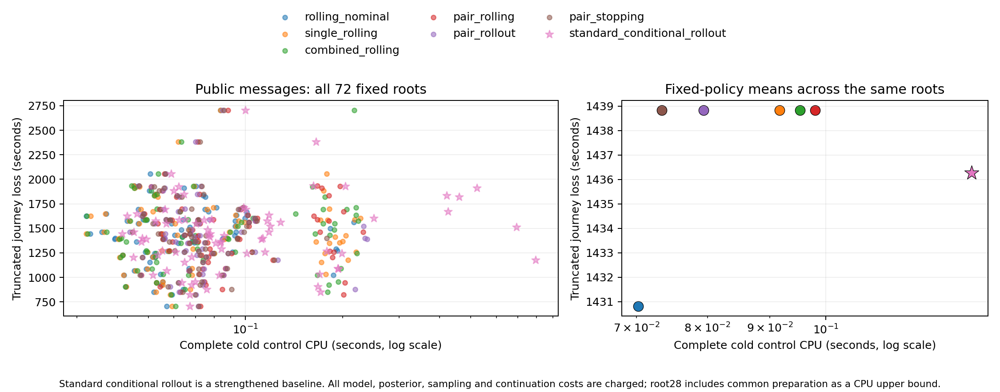

# V34：真实端点与决策前消息的自然事件发现

**已找到可执行的带消息事件及一个可修正的续程近似问题，G2 尚未通过。**
六个日期的 72 个根、两种信息条件、六种控制共 864 趟回放全部到达。随后独立
冻结标准条件 rollout，并对全部 72 根补跑，结果也全部到达；原结果保持原样。
补强修正一根、节省 184 秒，但仍比固定名义规则总计多损失 394 秒。

## 来源与冻结范围

本地和服务器联合清点了 19 个候选日期。服务器只返回 48,259 字节目录与审计
JSON，没有新增传输 CSV、模型或原始 GTFS-RT 包。原始消息从本地包抽取，
每条可用时刻为 capture、feed header、TripUpdate timestamp 的最大值。
本批 TripUpdate 均没有独立 timestamp；header 晚于 capture 的消息已延后处理。
这项复核没有发现此前漏用该字段造成的 G2 收益损失。

固定静态表版本为 20231024，主发现只用 10 月 25、26、27、28、30、31 日；
较早日期只记来源覆盖。主六日有 57,050 个数值预测更新、111 个 SKIPPED 端点
更新及 12 个 CANCELED 车次消息，均为消息计数，不是独立事故数。
预测和公告不替换真实端点；现场运营事实与未来公告分开处理。

筛选分母为 **362 个首车、3576 个首车–目标组合 → 1749 个拓扑根 →
1439 个菜单端点完整且有前序消息的根 → 72 个入选根**。每日期按固定顺序取
12 个不同首车，覆盖双枢纽、下游独有机会与多次换乘。选中菜单含 261 个枢纽、
1840 个续程变体，保留预先裁剪菜单内的全部退出点。选择只用静态结构、端点
覆盖和消息时机，没有使用损失、预测数值或算法优势。

模型原样复用 V5 的 10 月 1—2 日铁路拟合与同车 Markov 链。数值消息采用既有
Gaussian emission，带宽为训练路线标准差、至少 30 秒；最新消息替换旧消息，
不重复累计同一端点的预测。所有控制共用后验、公告可用性规则、MCT、菜单和截止。
见 [protocol.json](protocol.json)、[selection.json](selection.json)、
[source_inventory.json](source_inventory.json)、[messages_summary.json](messages_summary.json)。

## 配对结果

| 控制 | 仅自身与本站观察：平均损失（秒） | 再接公共消息：平均损失（秒） | 消息臂平均完整 CPU（秒） |
|---|---:|---:|---:|
| 滚动名义 | 1416.153 | 1430.806 | 0.0702 |
| 单目标 + 滚动下车 | 1418.181 | 1438.833 | 0.0916 |
| 组合 + 滚动下车（冻结主对照） | 1418.181 | 1438.833 | 0.0952 |
| 两目标 + 滚动下车 | 1418.181 | 1438.833 | 0.0980 |
| 两目标 + 一层 rollout | 1418.181 | 1438.833 | 0.0794 |
| 两目标 + 标准停止 | 1418.181 | 1438.833 | 0.0734 |

后五者在每个信息条件下，**72 根的完整动作序列和损失均逐项相同**。名义规则
在消息臂相对组合规则 2 胜、1 负、69 平：root21 多损失 491 秒，root28、33
分别少损失 184、885 秒。全部正负案例保留，没有按根挑最佳规则拼成基线。

同一组合控制接入消息后为 0 胜、3 负、69 平，平均多损失 **20.653 秒**。
名义控制为 1 胜、4 负、67 平，平均多损失 14.653 秒。这是固定模型在这批
事件中的执行表现，不是“信息本身无价值”或“预测必然有害”的结论。

CPU 包含新模型构造、消息处理、后验、菜单与全部尾值及动作计算；资料读取与
图准备另列。root0 的 12 格冷/热重放完整轨迹一致，热缓存仅对应相同历史重复
查询。标准停止是已有基线，本轮的小规模计时差异不构成新算法加速贡献。

原六控制图见 [quality_cpu.png](quality_cpu.png)。

逐日配对、控制矩阵与工时见 [summary.json](summary.json)，48 项跨控制或信息
条件的动作分歧及原始消息位置见 [divergence_catalog.json](divergence_catalog.json)。

## 条件参照与标准补强

按时间排序选出的四个公共历史，各用 128 个同车共享条件世界评估两个当前
动作，之后统一执行组合规则。未来消息不进入模拟，完整续程包括自身到站
观察、重新下车选择和尾站等待。两个平台分歧的条件结果相同；root21 支持
下车（继续相对贵 46.875 秒，SE 8.417），root28 支持继续（127 个完整配对平均
便宜 279.685 秒，SE 13.734）。root28 另 1 个时钟投影不兼容样本保留原质量，
全 128 样本的经验差值界仍为 [−283.602,−262.266] 秒。参照合计 CPU 2.414 秒。

root28 的原近似续乘差只有 +0.229 秒，而执行续程积分明显反向。这说明
“固定历史下首机会的尾值”与“实际会重观察、重选下车点及等待的尾策略”
之间存在有决策影响的差距；不能只因每格都有某个便宜规则选对，就宣布一个
固定便宜策略已经吸收全部差距。

因此单独冻结 [rollout_protocol.json](rollout_protocol.json)：在每次真实决策上，
只有名义与组合当前动作不同时才调用 128 世界标准 rollout；两个动作共用
世界，之后都执行组合规则。保留全部未解质量，仅在名义动作损失差的经验
上界小于零时切换，否则保留组合动作。不重试、不按实际结果切换规则。

全 72 根只触发 **7 次、896 个共同条件世界**，其中 6 对投影不闭合也保留。
仅 root28 切换为继续，实际省 184 秒：

| 同信息对照 | 标准补强胜/负/平 | 平均旅行收益（秒） |
|---|---:|---:|
| 组合、单目标、两目标、原 rollout、标准停止 | 1 / 0 / 71 | +2.556 |
| 固定滚动名义 | 1 / 1 / 70 | −5.472 |

补强平均损失为 1436.278 秒；计入全部条件化、抽样和续程计算后，平均控制
CPU 的保守上界为 0.1315 秒。root33 的条件 rollout 仍支持当前登乘，实际却
不及名义等待 885 秒；这不是再加同样前瞻就自然会修复的问题，也不能仅凭
这一实际世界断言模型错误。这里补做的是标准 rollout 基线，不是新算法。
见 [gated_summary.json](gated_summary.json)、[conditional_reference.json](conditional_reference.json)
及 [THEORY.md](THEORY.md)。



消息臂的三条负实现已逐条定位：root13、33、69 分别多损失 343、885、259 秒，
首次分歧前硬观察相同，预测都已合法收到，没有取消或跳站公告干扰。
见 [information_diagnosis.json](information_diagnosis.json)。

全项目验证：**674 项测试通过，15.79 秒**，见 [tests.log](tests.log)。

## 限制与下一步

- 六日均是开发发现日期，覆盖固定的 16 站、早高峰和预先裁剪菜单，不是全网
  普查或独立日期确认。初版目录漏接官方 MCT 时尚未运行策略；修正后重新冻结
  的目录用于全部正式结果，初版保存在 `before_mct_attachment/`。
- 信息模型没有生成未来预测修订。当前评分保持已收到消息，真实回放在后续
  决策时再更新；滚动尾值仍是声明的近似，不能称完整信息树最优。
- Gaussian 消息带宽未针对预测误差校准。当前数据支持“这套消息使用方式没有
  在本样本改善原控制的平均损失”，不能单凭少数实际损失判定具体分布已经错误。
- 旅行质量用逻辑时钟回放，CPU 单独完整计费；没有证明实时计算延迟下仍能
  执行全部动作。现场可乘仍沿用理想发车事件合同。
- 补强 pilot 的 root28 仅记录了包含公共数据准备的总 CPU；该根以总 CPU 作
  控制费用上界，未重复已付抽样。其余 71 根费用口径与原六控制一致，另列
  71 根计时敏感性。经验缺失结果界不是总体遗憾或置信证书。

当前不启动大型 DP、搜索或新的结构算法。若继续算法路线，先在独立于这批
评价结果的资料上验证消息条件模型，再用同一组便宜控制检查剩余行动差距；
真实前序消息已经找到，不能再把卡点笼统归为“没有数据”。

## 复现

```bash
python3 -m experiments.reconstruction_v34.build_sources
python3 -m experiments.reconstruction_v34.messages
python3 -m experiments.reconstruction_v34.discover
OPENBLAS_NUM_THREADS=1 OMP_NUM_THREADS=1 MKL_NUM_THREADS=1 python3 -m experiments.reconstruction_v34.run --workers 2
python3 -m experiments.reconstruction_v34.summarize
OPENBLAS_NUM_THREADS=1 OMP_NUM_THREADS=1 MKL_NUM_THREADS=1 python3 -m experiments.reconstruction_v34.conditional_reference
OPENBLAS_NUM_THREADS=1 OMP_NUM_THREADS=1 MKL_NUM_THREADS=1 python3 -m experiments.reconstruction_v34.run_gated --workers 2
python3 -m experiments.reconstruction_v34.summarize_gated
python3 -m pytest -q tests
```

原始源文件与冻结模型的路径保存在来源账本；消息提取和根执行均复用已完成文件。
