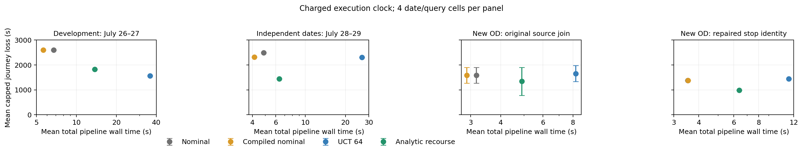

# V6：条件风险、解析补救估值与城市计算

新增完整当前网格模型的首动作下界、固定行程/首失败补救积分及换乘时间门；校准概率、条件采样与补救估值接通同一个联合后验。独立城市日期出现质量和计算双重改善，开发集及新OD的负结果保留。稿件未改。

## 为什么此前没有整体优势

- 小场景库确实会漏掉失败分支，但不是唯一原因。同一固定策略的精确值也会选择当天已经离站的班次；平均模型正确排序不保证单日获益。2/2分层抽样也没有统一方差优势，见 [同策略比较](itinerary_mc_RESULTS.md)。
- 重尾拟合改善区间宽度/interval score，不等于720秒内赶车概率更准。Student在三个新铁路日期中仅一天Brier胜Shrunk；两天组内也输了。连续CDF投到原60秒网格后最大catch概率偏差约0.22，已单列，未把连续覆盖保证直接转交给路由。
- 规划消耗时间后，查询起点的好班次可能已不可乘。开发长OD的解析策略因此从到达变为超时。一次执行时钟重估修复该例，却损害另外的日期，不能再称普遍改进。
- 训练零取消曾被当成线路不可能取消。Oct27已识别同车后续取消，使迟到组真实平均决策风险144.545秒，而模型约0.048秒。新服务风险授权函数拒绝证据不足的1秒认证，见 [风险及样本量推导](decision_risk_RESULTS.md)。

## 对应实现与理论

`CommitmentBounds`直接积分有序trip链，不依赖四个抽样世界。首失败在原站已知时刻返回、救援不再使用失败trip时，完整模型的可行策略成本为 `D−t−G(primary)−P(first failure)G(rescue)`。后续任一失败按deadline终止；真实执行此时再补救只会降低同世界的截断损失。固定救援的筛选下界与全因果最优下界分开记录。换乘时间门给出同buffer合同内的pathwise oracle下界。完整推导、复杂度及反例见 [结构结果](theory_risk_bounds.md)。

`RecourseItineraryRouter`最多积分8条候选，实际发布并执行primary/rescue。已提前发布的同车续乘不等待新的计算；新算首动作仍付计算时间。compiled nominal以相同发布机制隔离这项收益。`TripMarginalTilt`同时供全部root actions使用，保留同车联合关系、取消质量和已知事实；条件分支不改变根网格。12条已有铁路历史的匹配完整策略诊断中，base与共同Student后验选出相同行程，4个可识别状态损失相同、2个状态保留删失，未证明校准带来continuation增益，见 [配对结果](calibrated_continuation_results.json)。

## 冻结城市策略的匹配结果

全部使用July25过去训练、完整日期有效候选、相同旅客信息/MCT/720秒承诺/3600秒截止。UCT固定64次转移、4个私有世界；解析法固定8条候选，报告实际矩阵工作和全部运行耗时，不把零模拟转移当免费。下表为计算时间计入实际时钟后的平均截断损失，单位秒。

| 面板 | nominal | compiled nominal | UCT64 | 解析补救 |
|---|---:|---:|---:|---:|
| July26/27开发，4单元 | 2598.75 | 2598.75 | 1566.00 | 1825.00 |
| July28/29独立确认，4单元 | 2493.25 | 2313.75 | 2310.50 | **1448.00** |
| Oct25已有日期，2单元 | **1356.50** | **1356.50** | 1783.50 | 1439.00 |
| 两个新OD，已有July28/29，4单元 | [1269.25,1905] | [1269,1905] | [1340,1975.75] | [779.5,1905] |
| 同新OD，修复站名漏匹配后 | 1376.00 | 1376.00 | 1446.75 | **990.00** |

独立确认先锁原始controller文字、日期、OD和方法，才接入新实测；执行使用锁定的原始controller。[协议](city_confirmation_protocol.json)、[逻辑时钟](city_confirmation_logical.json)、[计费时钟](city_confirmation_charged.json)均保留。解析法4/4到达，UCT和两名义对照3/4；相对UCT每日期均值分别减少1366、359秒，整体减少862.5秒。平均整趟pipeline耗时6.371对26.648秒，决策处理5.843对26.125秒；共同训练成本另计。只有两个独立日期，四个单元不当四天。

新OD冻结为原端点的交叉组合，不按结果换OD。原始匹配中解析法有2条删失，其余方法各1条，损失差[-1196.25,565]秒；未用未删失均值下结论。继续定位发现五条首次缺测均为Brunnenhof/Radiostudio同站别名遗漏，以同provider车序、相邻已测段及计划分钟唯一确认后修复。原25训练和所有已知时钟不变，28/29补146/117条边。修复后重放冻结方法，新OD解析4/4到达、990秒，UCT3/4、1446.75秒；pipeline6.393对11.310秒。该来源敏感性没有新增独立日期。[身份依据](city_source_completion_NOTE.md)、[配对回放](city_source_completed_paired_charged.json)。初次把四OD合并索引时也改变了UCT随机流；该pilot保留，最终重新保持每个两OD面板的0/1随机流，16个首动作全部与原面板一致，未将种子变化当来源修复收益。

执行时钟重估属于另行锁定的secondary，开发1610.5、独立1567.25、Oct25为1665.5秒，未替换原primary；10次新规划的实际执行时钟有1次比估计晚1秒，因而没有精确延迟保证。

原生strict TopoCSA另补完整后验边际适配及8趟匹配回放：开发logical平均1559.75秒、4/4到达，charged为3540秒、1/4到达，出现16次计算期间错车。精确概率数组共享使query37.81→28.36秒，标签、删环、值及PMF逐项相同。此为每次决策重建后验的Python port；事件最多量化30秒，source clock最多向下取整58秒。没有据这个慢port推断已发表C++速度或算法复杂度优势。[强基线及成本](native_RESULTS.md)。

## 条件风险证据和限制

[校准结果](calibration_RESULTS.md)保留了旧25日、两轮各三个新actual日期、选择后覆盖和来源补全。旧25日Shrunk分组覆盖修复到92.42%/92.57%；Student在18/23/24日两组均超过90%，区间更窄，但概率没有全面胜出。保护任意菜单选择约需20分钟区间，旧25日仍失败。Oct28严格join的人口继续保留覆盖上下界；附加车次来源敏感性不冒称新的独立确认。

独立15/19/22日共151个原模型选中片段的实际风险均0；迟到组仅一个日期非空，且全部位于HB、采用声明420秒buffer。补上arrival-only取消与服务身份检查后，27日负例明确成立。仅1–2个训练日期无法支持1秒真实风险授权；保守服务guard全部拒绝。MCT门是合同内比较，GTFS最大声明buffer没有被当成任意平台对的物理最短换乘。铁路校准不外推城市，当前有限网格证明不自动给跨context自适应整趟保证。

OR方面已有具体可检查结构结果及独立城市正证据；一般上下界、macro、安全跳算和备用decision graph都有先例，未写成首创。最近先例差异及原生强基线另见 [理论对照](theory_risk_bounds.md)。这些证据没有证明任意条件风险都已校准、所有日期/OD全面领先或已达到OR接收门槛。

验证：337项核心、数据与校准测试通过；包含完整小链枚举、因果执行、计算延迟、共同后验和服务风险授权。主图同时给出开发、独立日期、原新OD删失区间及来源修复结果，未将它们混成一个均值。
