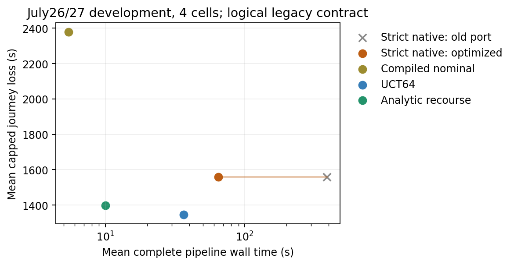

# 优化后的严格原生基线

已完整阅读两份新诊断。按其强基线要求，优化当前strict-native port；原文件、原V6数据和稿件不改。独立marginal、分钟表示、删环规则和严格均值标签均保留；`capped`根评分继续单列，不能称作者同目标算法。

首个Python区间最小值原型被真实城市profile否证：query28.53秒，对照26.80秒；热缓存仍14.82秒。该负结果及冻结源码保留在`baseline_profile_{protocol,results}.json`，没有选择性删除。

最终实现利用原CDF实际可见尾支撑判断successor的0/正概率；只有可证明正常浮点正下界时省去积分，极小乘积回原公式。原DFS实际约2972万次循环，用窄C++ kernel执行相同遍历、最早最小值tie-break和删环；没有改变渐近复杂度或减少候选。车辆链投影按公开belief revision和route参数复用，均值和积分复用相同概率数组。编译显式运行并另计；select中不编译。

| 同一完整城市root | 事件投影秒 | 原生query秒 | 其它一次设置秒 |
|---|---:|---:|---:|
| 原port冷缓存 | 7.151 | 26.575 | 共同graph/训练另列 |
| 优化冷缓存 | 7.479 | 6.426 | projector/workspace .393 |
| 优化热缓存 | .017 | 3.503 | 无完整结果缓存 |
| 一次真实乘车观测后 | .031 | 3.936 | 只重投影1/2173trip |

编译wall .422秒、compiler CPU .268秒。22913有效连接、10490个label、262081条cut及所有PMF逐位相同；观测后热/冷workspace结果也相同。计费包含拒绝的successor检查、矩阵投影、缓存维护和传播。profile进程峰值包含同时保留的旧/新图，不能当作新算法独立峰值比较。[全部成本](baseline_compiled_profile_results.json)。

4趟旧开发logical旅程结果835/2290/839/2275秒，4/4到达、每一步动作与V6相同。整趟pipeline分别34.24/93.80/36.94/92.93秒（旧182.27/582.70/184.17/607.90），平均64.47对389.26秒。路线质量没有因实现优化而改变；相同旧合同下，native均值1559.75仍劣于UCT64的1345.75。不能把加速解释为新结构定理，也没有重跑已知很慢的旧8趟板。[轨迹](baseline_native_logical.json)。

共同后台执行接口已提供：`last_native_result`保留全query结果，`export_issued_priorities()`复制stop→冻结strict-priority cid tuples，不重查后验，不依赖未来actual。优先序为原递推的reversed labels，与capped根单班次评分明确区分；真实可见上车及显式下车由root的共同发布器处理。该接口使原生法也能继续已发决策图，不把新方法独占后台执行当优势。

验证：11项优化测试及8项既有原生测试通过，包括有环与并列cut、所有标签/PMF、真实观测和参数变化的缓存失效、数值CDF尾、冻结priority副本；不额外扩充已settled测试。边界仍是分钟独立边际模型，事件量化与source floor未改变，不外推作者优化C++速度。新真实合同与同预算后台比较由共用执行实验单独判断。
