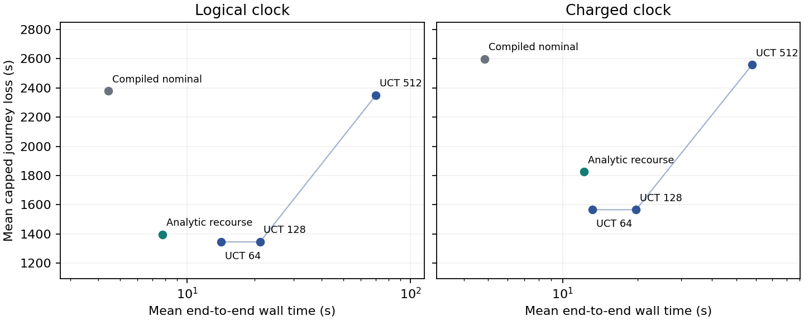

# 同模型规划预算与执行延迟

已补齐共享模型的城市预算曲线。两天各两个原有 OD，训练仍用 July25。全部方法共享有序车辆链、完整城市候选、公开信息、站级声明换乘合同和截断损失。UCT每次查询使用4个私有世界，转移上限64/128/512。解析补救最多估值8条候选行程。采用V6承诺执行器，计费时钟保留其已发布同车指令语义。共同事件执行的策略比较另有实验。

## 缓存优化与等价

UCT每次查询对许多模拟历史反复调用名义尾策略。新索引按站存储查询根的名义出发时间，只读当前尚可出发、能在截止前到达的连接。模拟观测更新的trip另取当前后验并重新放入索引筛选。对未变trip，删去的连接必定被原搜索的无运行均值、发车已过或到达超期条件淘汰。保留原连接次序、后续可行性检查和并列规则。索引局限于一次查询，各次真实观测后的查询重新构造，费用计入规划。

同一冻结根上，原版和优化版动作、估值、转移数、根动作覆盖及树节点逐项一致。短OD的64步冷查询CPU由5.48降到4.69秒，长OD的512步由69.62降到16.32秒。20条逻辑时钟轨迹与V5/V6档案的动作、反馈、损失和事件逐项相同。55项相关测试通过。两处共享源码仅允许候选索引接入，原调用继续全扫。

## 40条整趟对照

四个日期×OD在两种时钟下各跑5种方法。两物理核、BLAS单线程、最多2个worker，共同拟合另计。pipeline包含图、实测世界、后验与路由器构造以及全部规划和执行，图表与账本另列CPU、换乘与规划时钟、完整状态和每次决策成本。数据仍只有两个已查看日期。

| 方法 | 逻辑损失 | 计费损失 | 计费pipeline wall | 计费pipeline CPU |
|---|---:|---:|---:|---:|
| 编译名义 | 2378.50秒 | 2598.75秒 | 4.85秒 | 4.73秒 |
| 解析补救 | 1396.50秒 | 1825.00秒 | 12.18秒 | 11.76秒 |
| UCT64 | 1345.75秒 | 1566.00秒 | 13.17秒 | 12.67秒 |
| UCT128 | 1345.75秒 | 1566.00秒 | 19.75秒 | 18.97秒 |
| UCT512 | 2350.50秒 | 2558.75秒 | 57.98秒 | 55.42秒 |

解析补救在计费面板比优化UCT64少用0.99秒pipeline，旅程损失高259秒，分别到达3/4和4/4。优化压缩了V6中两者的计算差距。UCT512计费平均损失较原V5的2651.50秒有所降低，仍高于64和128。模型、执行及预算需分开判断。

预算64和128的逻辑损失均为1345.75秒。512虽然给同一组私有世界更多搜索时间，四格逻辑损失升到2350.50秒。July27短OD首选7588，估计值660秒，四个私有世界均可乘，完整当前模型失败概率约.548。实测该车在08:01:37离站，08:05才开始查询，失败后付720秒承诺等待。512在该根估值67/132个合法动作。将同一个已用根提高到2048步后，132个合法动作全部得到估值，仍选7588，估计值630秒，wall约23.76秒。这个单根对照将首层候选覆盖与固定世界缺失失败分支分开，后者依旧存在。[2048步根回执](budget_root_2048_results.json) · [V6分支积分](../reconstruction_v6/theory_risk_bounds.md)

July26长OD中，四种较低成本策略逻辑时钟都在29104秒登上8315。计费时钟下，名义编译、解析补救、UCT64和UCT128分别到29106、29112、29107和29109秒才执行，全部错过。解析补救最终超时，其他三种方法到达但各多花881秒。缓存提速仍未降到这条机会的4秒余量。

[全部轨迹](budget_results.json) · [费用及按日配对](budget_summary.json) · [冻结配置和源码](budget_protocol.json) · [冷启动等价](budget_pilot_results.json)
