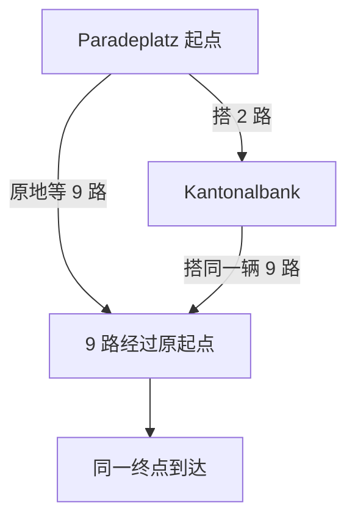

# 我:
**G2 仍未通过的核心原因是：目前新增的复杂方法，没有证明能提供强便宜基线拿不到的决策收益或净计算收益。** 代码、模型和实验可信度都在进步，但这些进步尚未组成一个成立的新方法贡献。

这次我重新核对了原始判据，并复算了 V31 的逐次决策收据。问题可以分清楚了。

**首先，G2 的要求没有在最近提高，但我们之前容易把不同层次的“通过”混在一起。**

原计划从一开始就要求“方法增量与实际计算价值”，包括强基线、相同信息、完整质量—耗时比较。V20 的三个“低于 60 秒”是特定模型内的遗憾证书；V31 的保留门允许“预测改善、策略表现不退”。它们通过，都不等于 G2 通过。[原始定义](/home/erzhu419/mine_code/BAPR-HRO/md/review_20261111_v2/plan_extracted.txt:129)

因此，V31 保留门通过与 G2 未通过并不矛盾。这个门检验的是模型是否值得保留，本来就没有要求它产生新的行动收益。

**其次，V31 没有收益的具体机制，已经定位到“分数变了，选择边界没有跨过去”。**

这不是新模型没有接进控制器。实际登乘、等待分数确实发生变化，单目标控制的内部目标甚至在四个历史中换过车，但当时的实际动作仍然都是等待。

排除没有后续候选的直接登乘分支后，我重新计算得到：

| 控制器 | 实质比较次数 | 新模型的成本差绝对值中位数 | 模型更新对成本差的平均绝对改变量 | 决策翻转 |
|---|---:|---:|---:|---:|
| 一步规则 | 93 | 313.59 秒 | 22.11 秒 | 0 |
| 单目标规则 | 148 | 399.38 秒 | 27.79 秒 | 0 |

决策依赖的是两种行动的**相对成本**。这些历史中，典型的选择间隙有三四百秒，而本次修正通常只改变二三十秒，逐条检查也确实没有跨过边界。因此，预测分布更准确，仍可以得到完全相同的乘车轨迹。[原始决策收据](/home/erzhu419/mine_code/BAPR-HRO/experiments/reconstruction_v31/results.json.gz)

V29 六根更能说明这个问题：站段修正把当前登乘成本平均上调 **30.119 秒**，把目标等待成本上调 **26.424 秒**。相减以后，预测等待优势反而从 **153.367 增到 157.062 秒**。目标成本的低估有所改善，但相对选择仍更偏向等待。

V31 出现的两次固定动作对翻转也没有创造新行为：实际滚动控制原本就已经选择等待，只是比较的目标车不同。[逐格诊断](/home/erzhu419/mine_code/BAPR-HRO/experiments/reconstruction_v31/diagnostics.json)

**更深一层的问题是：前面几条候选方法路线，都被强对照削弱了。**

- **精确评分路线：** V21 中，同菜单、零采样的名义规则逐世界复现 V20 的行为与损失，主测量中的完整计算成本还更低。精确积分有局部提速，但没有形成独立的整套方法优势。[V21](/home/erzhu419/mine_code/BAPR-HRO/experiments/reconstruction_v21/RESULTS.md)
- **完整等待 DP 路线：** V26 证明了更合理的等待策略有价值；V27 随后发现，便宜单目标规则在 768 个模型世界中逐个复现 DP，代理期望仅差 **0.000040 秒**。收益来自处理等待问题，尚不能归功于完整 DP。[V27](/home/erzhu419/mine_code/BAPR-HRO/experiments/reconstruction_v27/RESULTS.md)
- **证书省计算路线：** V10 搜索次数减半，但整趟计算由 **13.52 增至 34.34 秒**；直接利用公开承诺时钟跳过无效搜索则降至 **5.27 秒**。V11 确实取得约 **1.30 秒**的局部净节省，应当保留，但通过的五格都在同车尾程，复杂换乘三格仍拒绝。[V10](/home/erzhu419/mine_code/BAPR-HRO/experiments/reconstruction_v10/RESULTS.md) · [V11](/home/erzhu419/mine_code/BAPR-HRO/experiments/reconstruction_v11/RESULTS.md)

这几轮共同暴露的是：**我们尚未找到一个重要、自然出现、而且强便宜方法确实解决不好的剩余决策问题。** 在此前，继续精化积分、扩大 DP 或完善证书，容易增加计算和证明工作，却没有新增决策价值。

**新颖性还构成另一道独立障碍。**

即使单目标规则效果很好，也不能直接把它作为新方法中心。Liu 等的 Heuristic 2 已经比较“当前登乘”和“分别等待其他线路”的价值。当前项目的具名车次、截断损失、同车相关和公开历史处理确有区别，但还需要证明这些区别带来了什么新的结构结论、计算优势或重要洞见。[原论文第 4.3 节](https://arxiv.org/html/1808.04360v2#S4.SS3)

站段模型目前也处于类似位置：它改善了开发数据上的概率评分，但尚未显示行动增量。**9.06% 的 CRPS 改善是一个有效建模结果，不能换算成旅行时间收益，更不能直接换算成 OR 方法贡献。**

**对前面工作责任的判断，也应明确。**

V23 有实现错误，V24 有模型设计缺陷，修复它们是必要工作。到了 V27—V31，现有证据不支持继续把卡点归咎于“6.1 Sol 没把代码做好”。

计划层面的不足，是把强便宜基线和剩余决策价值的检查放得偏晚，先在少数状态上不断完善复杂方法。我此前也不应把“又完成一个局部修复或验收”持续表述成“方法贡献又接近成立了一步”。**否证实验做成功，可能意味着原研究路线应该结束。**

判断的边界也需要保留：V31 实际运行的是两种名义控制，当前菜单又固定了首乘后的下车点与尾程；这些负结果没有证明全网所有适应策略都无价值。两个日期已被开发使用属于 G3 问题，理想发车即登乘属于 G1 问题。它们会限制现实确认，但不能替代 G2 的直接原因；单纯增加日期也不会自动解决方法新颖性。

目前最准确的定位是：**项目已经形成了更可信的模型、执行器和强基线，但原来的复杂评分／等待求解／证书中心尚未成立。** 若保留算法论文定位，重新立项应先找到明确的剩余决策缺口；若转为建模研究，则应围绕模型如何改变决策、何时便宜规则已经足够建立可推广的结论。OR 允许重要的建模和性能洞见，并不要求所有状态都获胜，但要求贡献的重要性和新增内容能够被明确核查。[官方领域声明](https://pubsonline.informs.org/page/opre/editorial-statement/area-editors-statements)

# GPT：
**我的判断是：`86ba89c` 的执行基本到位，但目前仍没有找到足以支撑深重构的、强便宜基线解决不好的真实决策缺口。**

这次我把“寻找突破口”作为需要运行代码验证的任务处理了。除了核查 V30/V31、相关策略与执行代码、历次结果和理论边界，还补做了：

- **61 个自然小菜单的精确等待参照**，分别使用名义和完整条件 BOARD 代价；
- 最大残余状态的逐历史归因，以及一个**滚动两目标对照**；
- 恢复根车与尾车交叠、全部候选下车点、尾站控制和途中滚动重规划；
- 从现有完整网络抽取 **150 个新 OD**，按静态条件筛出 10 个无直达换乘根，再进行精确计算和实际回放；
- **52 项针对性测试**及一处数值稳定性问题的独立核查。

结果使下一步方向更明确了：**继续提高当前固定菜单内的等待求解精度，空间很小；简单恢复 BOARD 侧选项，也没有显现强基线之外的实际收益。接下来应先寻找“下游新增选择与决策前新信息共同影响不可逆行动”的自然任务，再决定算法如何重构。**

完整报告和本轮可复算材料已经整理好。报告共 16 页；审计包包含脚本、逐根结果、选择清单、缺测记录和复现入口。仓库保持未修改状态。

[BAPR_HRO_86ba89c_algorithm_gap_review_20261112.docx](https://chatgpt.com/library?file_id=libfile_0a7256bc3ad08191b6081da9595f9d51&account_id=personal)

[BAPR_HRO_86ba89c_audit_evidence_20261112.zip](https://chatgpt.com/library?file_id=libfile_080da0c87ab08191b4fa6c8609d654e2&account_id=personal)

---

## 一、这次提交没有“白做”，但它完成的是模型诊断

相对 `310ec65`，本次提交修改了 42 个文件，新增工作集中在 V30/V31 的诊断、模型、实验回执、测试和报告，**没有修改 `src/` 中的规划器**。V31 的站段模型位于实验目录中，已经正确进入既有控制器。

几个关键结果是相互一致的：

| 对象 | 当前结果 | 应当怎样理解 |
|---|---|---|
| 站段模型 | 4,148 个分组、46,122 条耗时记录；固定收缩权重 `n/(n+20)` | 一项有明确边界的建模细化 |
| 首机会完整成本预测 | 129 个共同标签，CRPS 从 76.814 降到 69.855 | 开发标签上的分布评分改善约 9.06% |
| 策略结果 | 146 个结果的首乘、尾车、损失、到达及状态相同 | 尚未产生旅程收益 |
| 公开决策 | 277 次决策的时刻、可见集合、已见集合及动作相同 | 模型改变了评分，没有改变实际行动 |
| V31 保留门 | 通过 | 符合“保留开发模型候选”的协议，不代表 G2 通过 |

这些边界在 [V31 结果](https://github.com/erzhu419/BAPR-HRO/blob/86ba89c327e5230f1290e8678bebcb589b2465a9/experiments/reconstruction_v31/RESULTS.md)、[协议](https://github.com/erzhu419/BAPR-HRO/blob/86ba89c327e5230f1290e8678bebcb589b2465a9/experiments/reconstruction_v31/protocol.json)和[模型实现](https://github.com/erzhu419/BAPR-HRO/blob/86ba89c327e5230f1290e8678bebcb589b2465a9/experiments/reconstruction_v31/model.py)中都表述得比较准确。

### 为什么预测改善没有改变动作？

我重新对齐了 V28 与 V31 的公开决策，剔除没有未来候选、只能登乘的情况，复现了已有诊断，并补查了组合等待控制：

| 控制 | 实质 BOARD/WAIT 比较 | 新模型代价差绝对值中位数 | 本次修正幅度均值 | 实际动作变化 |
|---|---:|---:|---:|---:|
| 一步控制 | 93 | 313.59 秒 | 22.11 秒 | 0 |
| 单目标控制 | 148 | 399.38 秒 | 27.79 秒 | 0 |
| 组合等待 | 148 | 400.36 秒 | 27.45 秒 | 0 |

这里的代价差是同一历史下“登乘代价减等待代价”。表格反映了尺度，逐状态核查则确认了零翻转。

**因此，“模型没有接到策略上”这个解释不成立。** 模型确实改变了 BOARD、WAIT 的评分，只是没有跨过实际决策边界。固定动作对中的两次排序翻转，也没有改变滚动控制当时正在比较的最佳目标。

这一轮执行已完成其承诺的工作。G2 不动，主要需要从研究对象和剩余算法价值解释。

---

## 二、我重新检查了当前等待问题，还剩多少可用空间

### 1. 扩到全部自然小菜单后，剩余仍然很小

这次检查覆盖既有 73 根中的全部 **61 个非空、\(K\leq8\)** 菜单：

- 42 个起点根；
- 19 个非空条件换乘根；
- 另外 6 个空菜单、6 个 \(K=17/18\) 大菜单不在本次穷解范围内。

使用最新站段模型，分别运行两套终端代价：

1. 当前控制器的名义 BOARD 代价；
2. 同一固定首路径、同一固定尾策略的完整条件 BOARD 代价。

后者仍是**固定续程内的完整积分**，不是一般网络中上车后任意适应策略的最优值。

| BOARD 代价 | 组合等待相对精确 DP 的最大根期望差 | 61 根等权平均差 | 实际回放 |
|---|---:|---:|---|
| 名义代价 | 5.5368 秒 | 0.3828 秒 | 61 根动作、尾程及损失相同 |
| 完整条件代价 | 4.3220 秒 | 0.2997 秒 | 61 根动作、尾程及损失相同 |

这是本轮新计算，原始回执在审计包的 `current/SUMMARY.json` 及两份逐根 JSON 中。

这里有两个需要同时保留的结论：

- **单目标和组合控制并非所有情况下都严格最优。** 原先如果把旧六例的相等推广成一般结论，会过头。
- **当前自然小菜单上的可利用剩余很有限。** 完整代价下的显著残余集中在同一日期、同一 OD 的六个相邻出发时刻，实际回放没有出现额外收益。

这也不能外推为六个大菜单已经解完，或完整网络没有适应价值。

### 2. 确实找到一个非预知的决策缺口，但两目标控制就吸收了

完整条件代价下，残余最大的根是：

`2023-07-17_2_31200_origin`

在这个根的某个可能公开历史中，当前时刻为 **08:44**。将所有绝对到达代价减去当前时刻，得到下面的期望剩余时间：

| 选择或等待参考 | 期望剩余代价 |
|---|---:|
| 当前上车 | 1516.55 秒 |
| 最佳单目标等待 | 1549.75 秒 |
| 等首个未来机会 | 1574.26 秒 |
| 精确多步等待 | **1467.25 秒** |
| 最佳两目标等待 | **1476.24 秒** |

于是：

- 当前组合控制选择上车；
- 精确 DP 选择等待；
- **只保留两个未来目标的小控制，也已经足够选择等待。**

这里存在真正的未来备选互补价值：当前车优于每个既有等待参考，但保留两个后续机会后，等待更好。

我进一步沿组合策略可达的全部公开历史计算了损失归因。该示例历史的概率约为 **0.0039426**，局部损失约 **49.30 秒**，对根期望损失贡献约 **0.19437 秒**；全部历史的贡献相加，恰好复现 **4.322015 秒**的根差距。

这排除了“只是预知下界太乐观”或者“小世界样本泄漏未来”的解释。

但关键的下一步结果是：

> 在当前组合控制之外，加入“所有两目标小 DP 中最好的等待参考”，并在每次公开机会到来时重选，所选最大残余根的期望差降到了数值零。

两目标参考在某些状态的价值仍不等于全 DP，但已经足够跨过正确的行动边界。**决定正确动作，并不要求把整个价值函数算到最精确。**

实际日期中，直达车在 **08:41:32** 就已经出现，组合、两目标和 DP 都登上同一辆车，旅行损失均为 **1428 秒**。“直达车尚未出现”的困难历史没有在该次实际路径中发生。

因此，这个发现适合用来建立更强基线和解释机制，**目前还不足以成为大菜单 DP 重构的依据**。两目标完整归因只针对这个最大残余根，不能据此宣布它对所有网络最优。

---

## 三、BOARD 侧确实有被简化的结构，但恢复后没有自动产生强基线收益

当前代码的限制是真实存在的。

[菜单构造](https://github.com/erzhu419/BAPR-HRO/blob/86ba89c327e5230f1290e8678bebcb589b2465a9/experiments/reconstruction_v24/screen.py)先为每个首车次保留一个计划最优下车点，再删除与根候选车次重叠的尾车；[BOARD 评分](https://github.com/erzhu419/BAPR-HRO/blob/86ba89c327e5230f1290e8678bebcb589b2465a9/src/transfer_opportunity.py)则计算固定首路径与固定尾策略的成本。

这说明现有精确值没有覆盖全部上车后适应性。**但“没有覆盖”与“存在有价值的算法缺口”之间，还需要实验。**

### 1. 本轮补了哪些便宜控制？

我检查了：

- 恢复 catalog 中的尾车；
- 尾站运行单目标与组合等待；
- 对同一首车保留所有候选下车点；
- 恢复 catalog 中被排除的首车，让根策略重新选择；
- 车辆每到一站后，用当时已经公开的实际到达时刻重新比较下车与续乘；
- 对六个相关根加入公开发车及未出现历史的同车条件传播。

结果如下：

| 检查 | 强基线下的结果 |
|---|---|
| 冻结首乘，恢复尾车或强化尾站控制 | 73 根损失不变 |
| 恢复 catalog 首车 | 48 个起点根损失不变；6 条改变首乘 |
| 再开放全部候选下车点 | 48 个起点根损失不变；9 条改变首乘 |
| 到每站再做名义重规划 | 可配对损失不变 |
| 六个相关根的同车条件传播 | 根选择及损失全部不变 |

必须补两个范围限定：

**第一，恢复重叠菜单的全 73 根探针采用逐路径边际均值启发式。** 它不是绕过独立性限制之后的“精确相关积分”。公开同车历史的传播只在六个相关根完整检查。

**第二，扩展目录后，有一个条件换乘根新增发车缺测。** 其余 24 个成对结果相同，不能删除缺测后写成全部 25 根无退化。

### 2. 两条看起来省了 473／501 秒的路径，为什么不算突破？

这两条路径值得特别解释，因为它们很容易再次把研究带偏。

恢复交叠尾车后，弱 first-offer 策略的损失分别从：

- 1481 秒降到 1008 秒；
- 1482 秒降到 981 秒。

逐车次核对发现，恢复的尾车与强基线在原起点等待的目标，**是同一辆 9 路**。

路径关系是：

| 根 | 弱首机会策略 | 恢复接驳后 | 原强单目标策略 |
|---|---:|---:|---:|
| 08:10 | 1481 秒 | 1008 秒 | **1008 秒** |
| 08:40 | 1482 秒 | 981 秒 | **981 秒** |

它们修复了一条被删除的可行接驳，但没有增加强策略可达到的终点机会。

进一步筛查全部 **286 个根状态—重叠尾路径出现项**：

- 尾站位于共同车次起点下游的有 124 项，上游有 162 项；
- 满足实际 MCT 的分别有 41、38 项；
- **“目标车已经离开起点，再坐另一辆车在下游追上”的合法见证为零。**

这些是重复路径计数，不是独立车次数或城市发生率。它们支持的判断是：**不能用删除了多少交叠项，推断恢复后会有多少方法收益。**

### 3. 留下了一条 45 秒的线索，但它仍是回顾余量

对 V31 已选首车，枚举出的 274 个下车候选中：

- 250 个结果可以确定；
- 24 个缺标签，涉及 12 个根；
- 已知的 250 个候选，没有一个改善原强基线的损失。

扩展首乘选择后，出现了一条回顾上可能再快 **45 秒**的路径：

- 先搭 2 路；
- 在 Stauffacher，当前控制选择下车转 9 路，损失 1008 秒；
- 事后看，继续坐到 Kalkbreite 再转 32 路，可以达到 963 秒。

问题是，在 Stauffacher 作决定时，后面的到站时间和 32 路实际发车都还没有公开。当时的均值评分反而认为继续乘坐**更差约 152 秒**。

所以这条路径目前可以作为排查入口。下一步应检查它是否存在决策前可识别的信号，或者标准链停止 DP 是否已经能够处理。**不能直接把事后快 45 秒，记成当时可实现的算法收益。**

---

## 四、换到新 OD 后，是否就出现了算法价值？

我又做了一次有预算的扩展，避免一直围绕旧四个 OD。

从现有 7/17 完整网络的 **701 个站点、28,164 个连接**中，固定随机种子、出发时刻和 40 分钟截止，抽取 150 个不同新 OD，排除旧四对。**先按静态时刻表筛选并保存清单，再读取实际结果。**

筛选过程是：

| 条件 | 剩余 |
|---|---:|
| 新 OD | 150 |
| 有非空菜单 | 33 |
| 候选数为 2–6 | 19 |
| 至少两条不同首乘线路 | 12 |
| 至少两个换乘选项 | 12 |
| 没有直达选项 | **10** |

10 根全部完成最新站段模型、完整条件 BOARD 代价下的精确计算：

| 策略 | 相对精确 DP 的平均根期望差 | 最大差 |
|---|---:|---:|
| 首机会 | 37.0137 秒 | 175.1631 秒 |
| 一步 | 0.0526 秒 | 0.5258 秒 |
| 单目标 | 0.6564 秒 | 6.0245 秒 |
| **组合等待** | **0** | **0** |
| **两目标等待** | **0** | **0** |

实际回放中，6 根完整、4 根缺测。完整六根的一步、单目标、组合、两目标和 DP 的公开动作轨迹及结果全部相同，平均损失 **1446.33 秒**。

这个扩展仍使用一次换乘受限目录，也不是全市频率调查。不过，它补强了一个很重要的判断：

**仅仅把现有根等待问题换到几个有换乘、没有直达的新 OD，仍没有得到组合等待之外的算法收益。**

---

## 五、综合起来，究竟是计划问题还是执行问题？

我认为目前应当这样归因。

### 1. 最近这一轮执行基本合格

V30 做了总体诊断，V31 按冻结规则试了一个变量，模型进入控制，负结果和缺测也保留下来了。

没有证据支持把主要问题归咎于“代码没接上”“没有认真跑完”或“执行者没有实现建议”。

### 2. 原先的研究安排过早确定了方法中心

此前很多阶段先确定：

- 精确评分；
- 更深等待；
- 更紧下界；
- 更大信息树；
- 更复杂相关模型。

之后才逐步加入真正有竞争力的便宜控制。结果，复杂方法的收益不断被简单修复吸收。

**下一阶段应改变这个顺序：先把便宜控制做到足够强，再观察剩余问题到底是什么。**

### 3. 当前实验对象压缩了不少可能产生动态价值的结构

现有主要问题往往是：

> 在一个平台上，从若干未来首车中选择一辆；每辆首车接着执行预设路径和预设尾策略。

这类问题可以很有用，但它的主要价值可能天然被以下规则获得：

- 当前车与一个未来目标比较；
- 首个未来机会与单目标比较；
- 少量两目标前瞻；
- 到站后滚动重算。

它没有充分覆盖：

- 多个途中下车点；
- 两次或更多换乘；
- 早期行动改变以后能获取的信息；
- 不同后续选项共享同一真实车次状态；
- 具有不同后续可达集合的枢纽选择。

这些是未覆盖范围，仍需先证明其中有实际且难以低成本解决的问题。

### 4. 预测、行动、旅行收益和算法贡献被期待得太接近了

实际上它们之间有好几道门：

\[
\text{预测改善}
\;\longrightarrow\;
\text{行动改变}
\;\longrightarrow\;
\text{实际收益}
\;\longrightarrow\;
\text{强基线之外的方法增量}.
\]

每一步都可能没有发生。V31 主要完成了第一步；本轮两目标例子说明，即使找到了行动层面的模型缺口，也可能被很小的已知控制消除。

### 5. 有一处需要修的数值问题，但它不解释 G2

本轮发现，极低生存概率下，`wait_score` 用两个接近 1 的 CDF 相减，再除以很小的条件概率，会放大浮点误差。

在所选最大残余根中：

- 条件评分差最大约 34.89 秒；
- 最极端例子的生存概率约 \(5.6\times10^{-17}\)；
- 对全部可达状态核查后，**动作变化概率和损失归因变化均为零**；
- 改用非负概率原子的区间求和，与独立递推的差约为 \(1.46\times10^{-11}\)。

应当做一个小范围稳定性修复和回归测试。它属于实现维护，不能承担新的方法贡献叙事。

---

## 六、下一步真正值得找的缺口是什么？

我建议把候选问题收紧为：

> **早期上车或下车决定，会改变乘客以后能访问的枢纽、可见信息和续程集合；多个续程还共享真实车次状态。在这种结构下，便宜滚动控制是否仍然错误地放弃了有价值的后续选择？**

这比“再做 BOARD”“加相关性”“多一步前瞻”更具体，也更容易被证伪。

### 一个值得筛查的自然情形

下面是**研究情形示意，不是本轮已经证实的正例**：

- 当前车辆后续经过 A、B 两个换乘点；
- A 有较快但低频的接驳，B 有不同方向的备用；
- 在 A 下车会失去继续到 B 的机会；
- 继续坐到 B 又会错过 A 的接驳；
- 途中合法公开信息会改变这些机会的相对价值；
- A、B 的后续路线不能由起点等待同一辆车简单复制；
- 对共享车次的观察，会同时改变多个续程的条件分布。

在这里，真正需要比较的是**保留未来适应机会的价值**。

但仍然必须先击败便宜控制。满足拓扑条件，只是开始。

### 我建议要求五项证据同时成立

| 要求 | 必须看到什么 |
|---|---|
| 后续机会确实不同 | 下游提供起点不能直接获得的路线或后续选择 |
| 信息在决策前可用 | 自己的到站、本站机会或有发布时间的消息已经公开 |
| 行动具有不可逆后果 | 现在下车或继续乘坐会失去不同机会 |
| 强便宜控制仍有损失 | 滚动名义、组合、两目标、链停止仍留下有价值的差距 |
| 确实需要新求解方法 | 已知方法在自然规模上仍存在质量或总计算成本瓶颈 |

尤其要防止一个问题：离开起点后，如果乘客看不到起点，就不能继续把“没看到目标车发车”当作新的未出现证据。共享车次必须是一条连续潜在过程，不能到了下游重新生成一辆独立车辆。

---

## 七、先把哪些基线补齐，再决定算法？

我建议下一阶段累计保留以下对照。

### 第一层：共同的合法动作与信息

所有方法使用相同：

- 首乘、下车点和换乘深度；
- MCT、截止和损失；
- 同车身份和条件模型；
- 公开信息范围及发布时间；
- 缺测处理。

如果恢复了一个选项或修正了后验，也要给基线同样的接口。

### 第二层：便宜滚动控制

至少包含：

- 每次合法公开事件后的名义最早到达重规划；
- 单目标等待；
- 组合等待；
- 滚动两目标等待；
- 一个明确的小深度 rollout。

主基线应在开发阶段冻结。不能逐实际路径事后挑表现最好的控制，拼成一个不可执行的“最佳基线”。

### 第三层：标准的多下车点最优停止

如果车辆依次经过 \(m\) 个可下车点，声明状态足以描述车辆演化，途中没有遗漏的外部后验更新，设：

- \(G_r(t)\)：第 \(r\) 站时刻 \(t\) 下车并执行共同尾策略的成本；
- \(K_r(t,t')\)：继续到下一站的条件转移；
- 失败进入截止成本的吸收状态。

则标准递推为：

\[
V_r(t)=
\min\left\{
G_r(t),
\sum_{t'}K_r(t,t')V_{r+1}(t')
\right\}.
\]

稠密核计算量为 \(O(mT^2)\)，稀疏核可写成 \(O(mTd)\)，**另计所有尾值的编译成本**。

这个递推应先作为更强便宜基线。它本身是标准最优停止，不能因为应用到多个下车站，就直接列为 OR 新方法。

### 第四层：同信息的小规模精确参照

只有在前三层后仍有剩余，才用精确信息树等工具确定：

- 缺口究竟来自候选、预测还是前瞻；
- 哪个公开历史需要不同动作；
- 该历史的发生概率和整趟贡献；
- 更便宜的小结构是否已经足够。

这里必须继续防止 V15 式的有限世界提前识别：相同公开前缀、不同未来的模拟世界，应当产生相同当前动作。

---

## 八、如果缺口真的存在，算法深重构应落在哪里？

我会优先考虑**共享车次条件续程的状态与计算结构**，而不是重新给一个一般规划器加框架名称。

可能值得研究的具体对象有四个。

### 1. 哪些历史必须保留，哪些可以安全遗忘？

需要证明某个车次的历史已经不会影响：

- 后续可行动作；
- 未来公开信息；
- 任何仍可能采用的续程成本。

满足这些条件后，才允许从状态中移除。仅凭当前图上没有直接连边，不足以安全遗忘。

### 2. 同一车次在多个候选位置出现时，怎样复用条件消息？

应给出：

- 同车前向、后向消息的复用条件；
- 非出现证据如何传播；
- 哪些尾值可以共享；
- 什么信息更新会使缓存失效；
- 什么时候分解无效、必须保留联合状态。

“复用消息”本身并不新。新结果需要说明**某种交通结构允许保留必要适应性，同时显著降低求解代价**。

### 3. 复杂度由什么结构参数控制？

如果走影响图或变量消元路线，不能直接承诺“只与局部车次数有关”。

因为观察和决策次序限制了求和、最小化的交换。普通依赖图的 treewidth 小，不自动意味着因果规划便宜。需要针对声明的结构类证明：

- 充分状态；
- 合法消元顺序；
- 相应宽度或活跃状态规模；
- 最坏情况下如何退化。

### 4. 是否有完整计费后的价值？

最终需要展示：

- 相同策略质量下更低的总计算成本；或
- 相同计算预算下更好的决策结果。

后验、候选维护、尾值编译、缓存、证书和失败回退都要计费。当前探针的运行时间只是审计开销，不应拿来作为生产算法的速度结论。

这些仍是**条件性的研究命题**。目前没有足够证据预先承诺其中哪一个能够成为论文贡献。

---

## 九、为什么这些要求与 OR 标准直接相关？

相关文献已经覆盖了很多容易被当作新方向的对象：

- **Liu 等**已经研究随机到站次序、子集 DP、支配和逐单线路等待比较。当前“比较现在上车与等待一个目标”的思路有直接近邻。[arxiv.org](https://arxiv.org/html/1808.04360v2?utm_source=chatgpt.com)
- **MEAT**已经使用带备选续程的决策图优化期望到达；**Durner**也处理中间站备选和持续更新，并明确指出，在某些换乘时间与持续确定性重规划设置下，随机方法的额外收益会很小。[drops.dagstuhl.de](https://drops.dagstuhl.de/entities/document/10.4230/OASIcs.ATMOS.2014.1?utm_source=chatgpt.com)
- **Bérczi 等**研究到站时间相关的多服务策略；**PROTRIP**已利用相关行程时长和上游实时信息更新下游分布。因此，“多服务”“相关更新”“实时 DP”单独都不足以建立新颖性。[real.mtak.hu](https://real.mtak.hu/86687/1/1-s2.0-S0166218X18302920-main.pdf?utm_source=chatgpt.com)

审稿人 2 的原报告明确质疑的是方法贡献强度，同时指出理论错误、半径校准和模型适用性问题。最近的工程修复回应了一部分可信性要求，方法中心仍需重新建立。[审稿人 2 原报告](https://github.com/erzhu419/BAPR-HRO/blob/86ba89c327e5230f1290e8678bebcb589b2465a9/md/review_20261110/report_B_OR_hyperpath_DRO.txt)

OR 交通领域的编辑声明强调问题的重要性与严谨分析，主要评价标准是意义和贡献。它并不要求每个工况、每个随机世界都领先。**旧 60 秒证书门也不是 OR 的统一标准。**[pubsonline.informs.org](https://pubsonline.informs.org/page/opre/editorial-statement/area-editors-statements?utm_source=chatgpt.com)

对于你明确选择的算法论文方向，我认为需要形成下面这一条完整论证：

> 一个重要的真实决策障碍 → 一个现有方法没有充分利用的结构 → 一个具体的新算法结果 → 匹配强基线下的质量与计算优势 → 独立确认其适用范围。

目前最缺的是前两项之间的连接。

---

## 十、下一步按什么顺序推进

我建议安排一个 **6–10 个工作日的问题发现阶段**。本轮已经完成的 61 根、BOARD 补全和新 OD 探针进入基线包，后续不用重复证明同一件事。

| 阶段 | 实际工作 | 必须交付 | 继续条件 |
|---|---|---|---|
| 第 1–2 日 | 从完整网络按双枢纽、下游独有线路、多次换乘筛查询；明确公开信息合同 | 全部候选及筛选分母、合法性和数据覆盖账本 | 存在不同未来机会的自然结构 |
| 第 3–4 日 | 共同动作与后验下运行滚动名义、组合、两目标、链停止及小精确参照 | 菜单、模型、策略三部分归因；动作与实际结果配对 | 强便宜控制之后仍有可解释、有价值的残余 |
| 第 5–6 日 | 只对一个幸存机制写最小数学问题和原型 | 状态、观察、目标、结构命题、复杂度、失效条件 | 超出标准等待 DP 或链停止，且确有规模瓶颈 |
| 第 7–8 日 | 比较新结构方法与优化过的已有方法 | 完整质量—计算成本曲线，冷启动和热缓存分开 | 同质量更省总成本，或同预算取得额外决策价值 |
| 第 9–10 日 | 冻结唯一方法、全部基线和主指标 | 真正未参与选择的新日期或事件确认协议 | 发现结果不依赖单一 OD 的相邻窗口或未来信息 |

### 我建议下一次提交具体交付三样东西

**第一，维护性修复和强基线固化。**

修复极小生存概率下的条件区间概率计算；把两目标控制纳入统一基线接口。保留现有物理执行、车次身份和数据处理，不必重写这些已经工作正常的基础设施。

**第二，一个真实决策缺口目录。**

每条记录至少包含：

- 根与公共历史；
- 当前可见信息及其时间；
- 合法上车、继续、下车选择；
- 下游新增机会及共享车次；
- 各便宜控制的动作与条件值；
- 精确参照的差异及概率贡献；
- 实际结果、缺测和计算成本；
- 为什么该例没有被更简单的修复吸收。

目录选择依据应在读取最终损失之前保存。

**第三，一份单一算法主张的立项合同。**

只有目录出现幸存机制时，才写清楚：

- 新方法解决哪一类现实决策；
- 输入、输出、信息和动作边界；
- 要证明哪个结构结果；
- 必须超过哪些已有方法；
- 哪些结果会否定这条路线。

如果剩余只有模型修正，就完成模型工作；如果标准链停止已经足够，就保留它为强基线；如果只能靠看到未来获得优势，就结束该机制。独立日期验证应放在方法与基线冻结之后，不能靠继续增加开发日期替代这一步判断。

**我现在最明确的建议，是把下一阶段的主要投入放到自然决策结构的发现和强便宜前沿的核查上。深重构应以经过这些对照验证的、可复算的现实决策缺口为启动条件。**